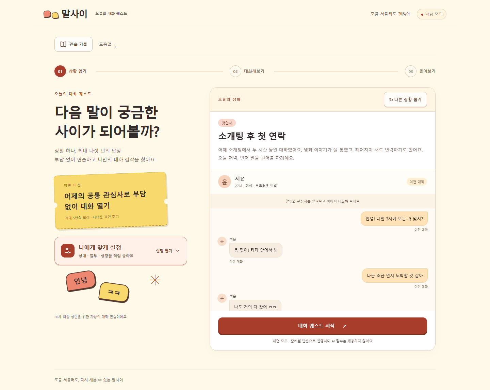
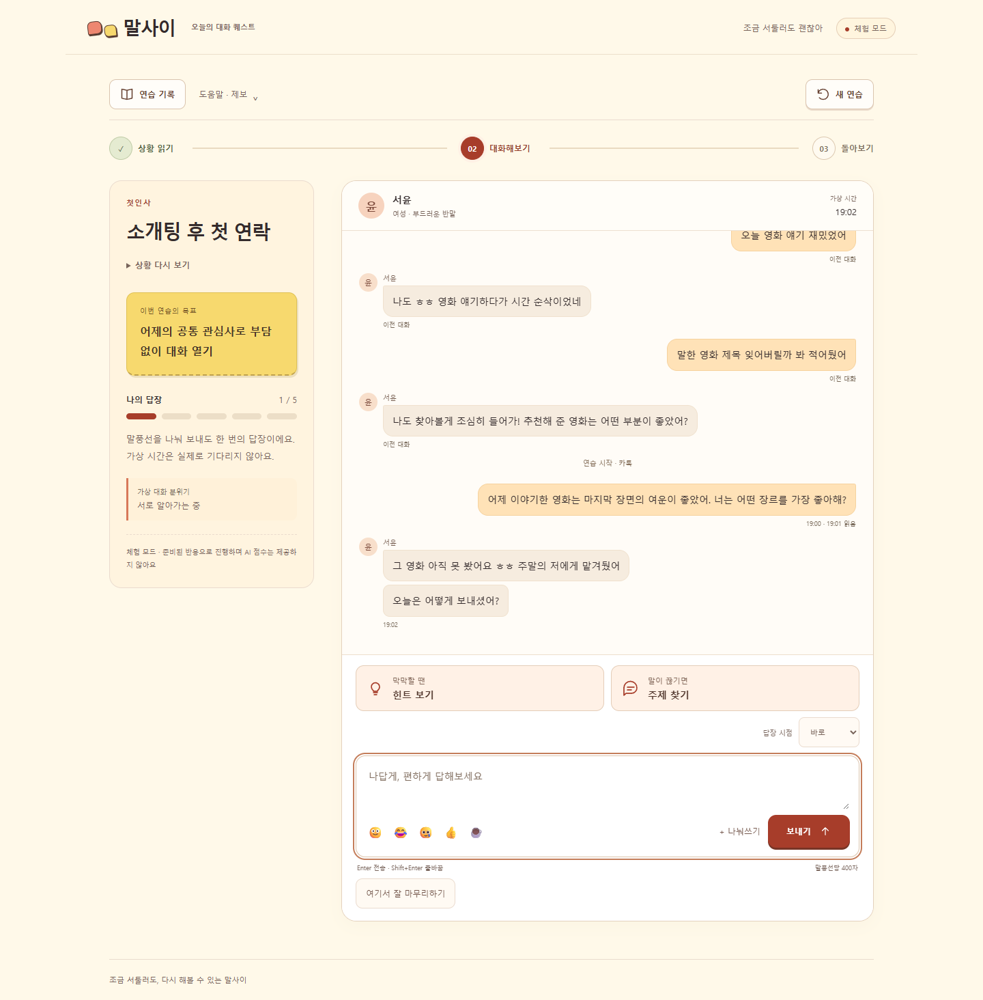

<p align="center">
  
</p>

<h1 align="center">말사이</h1>

<p align="center">
  <strong>대화 사이를 읽는 AI 썸 채팅 연습</strong><br>
  상황을 읽고, 나답게 답하고, 다음 대화를 위해 돌아봅니다.
</p>

<p align="center">
  <a href="#화면으로-보기">화면으로 보기</a> ·
  <a href="#구현-포인트">구현 포인트</a> ·
  <a href="#로컬에서-실행하기">실행하기</a> ·
  <a href="#프로젝트-문서">문서</a> ·
  <a href="https://github.com/yoon778">개발자 프로필</a>
</p>

소개팅 이후처럼 답장이 막막한 순간을 메신저 형태로 연습하는 **한국어 대화 게임 프로토타입**입니다. 상대의 성향과 앞선 대화를 읽고 최대 5번 답장한 뒤, 잘한 점과 개선할 행동을 복기합니다. 한 번 이상 답장했다면 일찍 마무리하고 실제로 나눈 대화만 돌아볼 수도 있습니다.

| 구성 | 사용 기술 |
| --- | --- |
| 화면 | HTML · CSS · JavaScript ES Modules |
| 서버 | Node.js 24 이상 · 기본 HTTP 모듈 |
| AI | OpenAI API · 구조화된 JSON 응답 · 대화/코칭 역할 분리 |
| 기록 | SQLite · AES-256-GCM으로 기록 데이터 암호화 |
| 검증 | Node.js Test Runner · 평가 사례 검증 · AI 실험 스크립트 |
| 출시 준비 | Render 설정 · Apps in Toss / Vite 빌드 구성 |

## 화면으로 보기



<details>
<summary>메신저 대화 화면 펼치기</summary>



</details>

2026-10-13에 저장소 코드를 로컬에서 실행해 캡처한 실제 UI입니다. 화면 속 인물과 대화는 가상 예시이며, **체험 모드**는 준비된 반응을 사용하고 AI 점수를 제공하지 않습니다.

## 핵심 경험

1. **상황 읽기** — 소개팅 후 첫 연락, 스토리 답장, 농담 뒤 수습 등 13개 상황에서 이전 대화와 목표를 확인합니다.
2. **대화해보기** — 인물별 말투, 1~3개 말풍선, 읽음 상태와 가상 답장 시간으로 짧은 대화를 연습합니다. 막막할 때는 힌트와 주제 이어가기를 사용합니다.
3. **돌아보기** — AI 모드에서 전체 평가와 답장별 복기를 확인합니다. 원문, 개선 이유, 다른 답장 예시와 후속 행동을 함께 살펴봅니다.
4. **다시 시도하기** — 같은 상황이나 특정 차례를 다시 해보고, 새 상황에서 한 문장 복습으로 이어갑니다.

답장이 늦는 상황에서는 30분·2시간의 **가상 시간**을 넘길 수 있습니다. 실제로 기다릴 필요는 없습니다. 대화 품질 제보는 사용자가 동의한 맥락과 모델·프롬프트 버전을 함께 기록합니다.

## 구현 포인트

| 해결하려는 문제 | 구현한 방식 | 코드 |
| --- | --- | --- |
| 답장 도착 시각과 재도전 결과가 뒤섞이지 않도록 | 서버가 가상 시간과 대화 단계를 관리하고, 체크포인트로 특정 차례를 복원합니다. 실패한 생성 요청은 차례를 소모하지 않습니다. | [대화 상태 관리](./lib/game.js) |
| 대화 상대·코치·평가자의 역할을 구분 | 역할별 요청을 나누고 JSON Schema로 응답 형태를 제한합니다. 기본 모델은 `gpt-5.4-mini-2026-03-17`입니다. | [AI 연결](./lib/ai.js) · [모델 설정](./lib/models.js) |
| 실제로 하지 않은 답장을 평가 근거로 삼지 않도록 | 배경 대화와 사용자 답장을 분리하고, 평가의 근거 메시지 ID·점수 범위·중복 항목을 검사합니다. 체험 모드에서는 점수를 만들지 않습니다. | [평가 검증](./lib/game.js) · [코칭 원칙](./lib/coaching-principles.js) |
| 대화와 진행 상태를 다시 이어가기 | SQLite에 기록 데이터를 암호화해 저장하고 소유자별로 조회합니다. 웹 모드에는 서명·만료 검증을 갖춘 브라우저 세션을 구현했습니다. | [저장소](./lib/store.js) · [웹 세션](./lib/web-session.js) |
| AI 요청의 비용과 중복 실행 관리 | 호출 전 예상 비용을 예약하고 응답 사용량으로 정산합니다. 일·분 사용량, 동시 요청, 완료 요청 재처리도 제한합니다. | [예산 관리](./lib/ai.js) · [API 처리](./server.js) |

대화 기술 평가는 학습을 돕는 피드백입니다. 사람의 매력이나 현실의 호감 확률을 측정하지 않습니다. 명확한 표기 오류 일부만 별도 안내하며 채팅식 표현과 가벼운 오타는 일괄 교정하지 않습니다. 적용 범위와 실험 기록은 [상황 기믹·코칭 문서](./docs/conversation-gimmicks.md)에 정리했습니다.

## 로컬에서 실행하기

**Node.js 24 이상**이 필요합니다. 기본 웹 실행은 Node 내장 모듈을 사용하므로 별도 패키지 설치 없이 시작할 수 있습니다.

```bash
git clone https://github.com/yoon778/mal-sai.git
cd mal-sai
npm start
```

브라우저에서 <http://localhost:3000>을 엽니다. AI 설정이 없는 기본 실행은 체험 모드입니다.

- 로컬 기록은 재시작 후 복원하며, 마지막 저장 후 30일간 보관합니다. 브라우저 식별값을 지우면 이전 기록에 다시 접근할 수 없습니다.
- 화면 비교용 [디자인 초안 3종](http://localhost:3000/designs#b)은 로컬 서버 실행 후 볼 수 있습니다. 이 시안은 API를 호출하지 않습니다.
- 토스 패키지 빌드 도구가 필요할 때만 `npm ci`를 실행합니다. 이후 절차는 [토스 출시 준비](./docs/toss-release.md)를 참고하세요.

<details>
<summary>실제 AI 연결과 실험 명령</summary>

`.env.example`을 `.env`로 복사하고 `OPENAI_API_KEY`와 `AI_ENABLED=true`를 설정한 뒤 서버를 재시작합니다. 키는 서버에서만 읽으며 Git에 올리지 않습니다. 아래 명령은 실제 API를 호출하므로 사용료가 발생할 수 있습니다.

```bash
npm run smoke:ai -- --limit 1
npm run eval:ai -- --limit 3
npm run realism:ai
npm run reliability:ai
```

`smoke:ai`는 한 상황을 완주하며 응답 시간·토큰·추정 비용을 `.data/smoke-live-*.json`에 기록합니다. 예산 제한은 이 앱의 추정 AI 비용을 관리하며 호스팅비나 다른 프로그램의 호출 비용을 포함하지 않습니다.

사용자 테스트 설문은 [진행 가이드](./docs/user-test-guide.md)를 따르며, 다음 명령으로 로컬 집계를 확인할 수 있습니다. 설문 레코드에는 대화 전문을 복사하지 않습니다.

```bash
npm run feedback:summary -- --participants 5
```

</details>

## 검증과 현재 범위

```bash
npm test
npm run eval:validate
```

2026-10-13 기준 기존 자동 테스트 **80개**, 평가 기준 사례 **30개**의 데이터 검증을 통과했습니다. 자동 테스트는 모의 AI 응답을 사용합니다. 평가 사례는 5개 상황과 강함·약함·혼합 답장으로 구성되어 있으며, 데이터 검증 통과가 실제 AI 평가 품질이나 학습 효과를 뜻하지는 않습니다.

- **구현됨** — 대화·힌트·복기·재도전, 기록 복원, 사용량 제한, 웹·토스 실행을 위한 구성
- **추가 확인 필요** — AI 자연스러움과 학습 효과의 사용자 평가, 실제 공개 서비스 배포, 토스 실기기·인증 연동 검증

이 저장소의 공개 서비스 URL은 아직 안내하지 않습니다. [웹 배포 문서](./docs/web-release.md)와 [토스 출시 문서](./docs/toss-release.md)는 준비한 구성과 남은 절차를 구분합니다. 이전 AI 실험 결과는 각 문서의 실행 시점에 해당하며 현재 성능 보장으로 사용하지 않습니다.

## 프로젝트 문서

| 문서 | 내용 |
| --- | --- |
| [제품의 출발점](./docs/product-foundation.md) | 대상 사용자와 짧은 대화 연습의 목표 |
| [상황과 코칭 설계](./docs/conversation-gimmicks.md) | 선연락·가상 시간·표기 안내·복기 원칙 |
| [디자인과 AI 실험](./docs/design-and-ai-update.md) · [버튼 배치 근거](./docs/control-designs-2026-09-09.md) | 화면 선택과 상호작용 설계 기록 |
| [구현 기록](./docs/implementation-status.md) · [로드맵](./docs/hackathon-roadmap.md) | 초기 구현과 후속 작업 이력 |
| [사용자 테스트](./docs/user-test-guide.md) | 테스트 진행과 설문·집계 방법 |
| [웹 배포 준비](./docs/web-release.md) · [토스 출시 준비](./docs/toss-release.md) | 운영 설정, 검증 범위와 남은 출시 절차 |

## 함께 보기

[개발자 프로필](https://github.com/yoon778) · [기특해](https://github.com/yoon778/giteukhae) · [26 WinAPI No Save Love Project](https://github.com/yoon778/26_WinAPI_No_Save_Love_Project)
